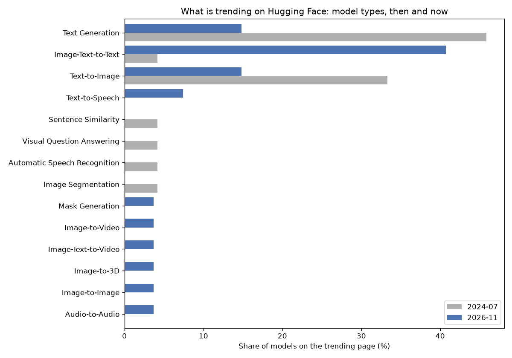
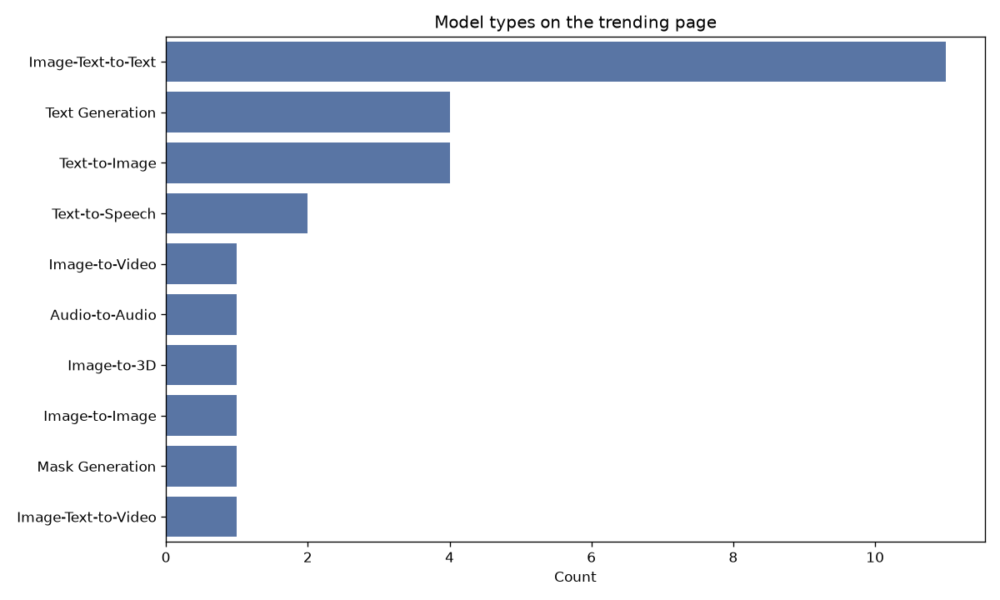
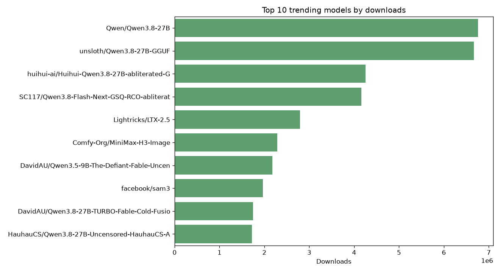

# huggingface-model-trends

抓取 Hugging Face 模型页的热门榜，看现在大家都在下载、点赞什么类型的模型，帮助判断选型和研究方向。

A small scraper for the Hugging Face trending models page: it collects each model's type, size, downloads and likes, counts model types, and draws charts. Two snapshots are kept so the change over time is visible.



## 两次快照看到了什么

热门榜前 30 个模型里，按类型算占比（类型为空的不计）：

| 类型 | 2024-07 | 2026-11 |
| --- | ---: | ---: |
| Text Generation（纯文本大模型） | 45.8% | 14.8% |
| Image-Text-to-Text（图文多模态） | 4.2% | **40.7%** |
| Text-to-Image（文生图） | 33.3% | 14.8% |
| Text-to-Speech（语音合成） | 0% | 7.4% |
| 视频 / 3D / 音频类 | 0% | 18.5% |

- 两年前热门榜几乎被纯文本模型和文生图模型包圆；现在最多的是**图文多模态**，新的大模型（比如 Qwen3.8）本身就是多模态发布的。
- 视频、3D、语音这些类型从无到有，热门方向明显变散了。
- 下载量最高的不只是原版模型，还有大量社区做的 **GGUF 量化版**，说明很多人在本地跑模型。

> 注意：每次只抓热门榜第一页（30 个模型），是一个时间点的快照，不是长期统计；结论只说明“当时热门榜上是什么”。

## 图表

| 2026-11 模型类型 | 2026-11 下载量前 10 |
| --- | --- |
|  |  |

`charts/2026-11/` 里还有点赞数前 10 和类型词云。

## 怎么用

```bash
pip install -r requirements.txt
python crawler.py                         # 抓当前热门榜 → data/<年-月>/ 和 charts/<年-月>/
python compare.py data/2024-07 data/2026-11   # 两次快照对比 → charts/compare.png
```

## 实现

- `crawler.py`：`requests` 取页面，`BeautifulSoup` 解析每张模型卡片；卡片上那一行说明（类型 • 参数量 • 更新时间 • 下载量 • 点赞数）**按内容识别字段**，不按位置——新版页面多了参数量（如 `9B`），按位置取会整行错位；`29.6k`、`6.76M` 这类数字统一换成整数；`pandas` 统计类型，`seaborn` / `wordcloud` 出图，图直接存文件，服务器上也能跑。
- `compare.py`：读两次快照的类型计数，换成占比画在一张图里。
- `data/2024-07/`：第一次抓取（2024 年 7 月）的原始数据；`data/2026-11/`：2026 年 11 月重新抓取。

## 局限

- 只抓网页第一页。要更多、更稳定的数据，应改用 Hugging Face 官方 API（`huggingface_hub.list_models`）。
- 网页结构变了解析就会失效；抓不到卡片时脚本会直接提示。
